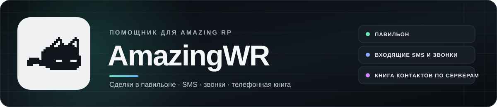
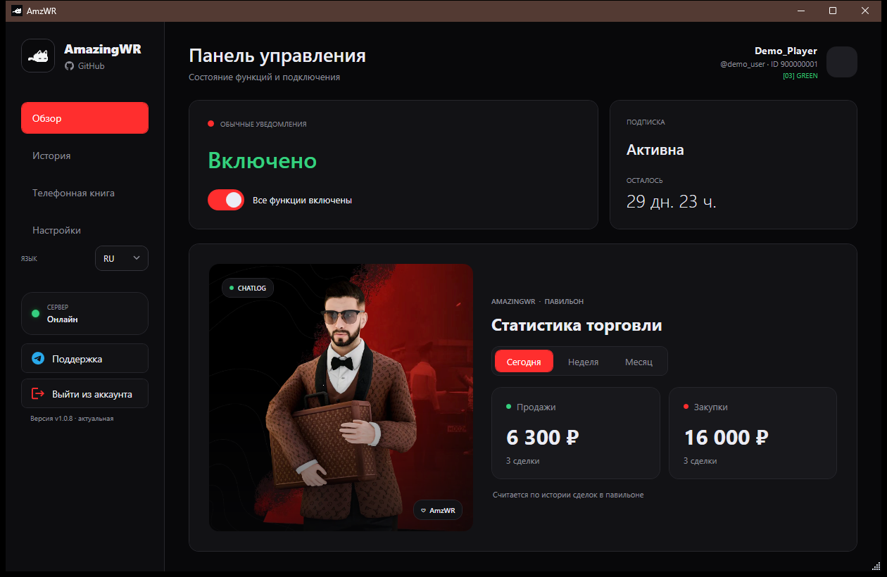
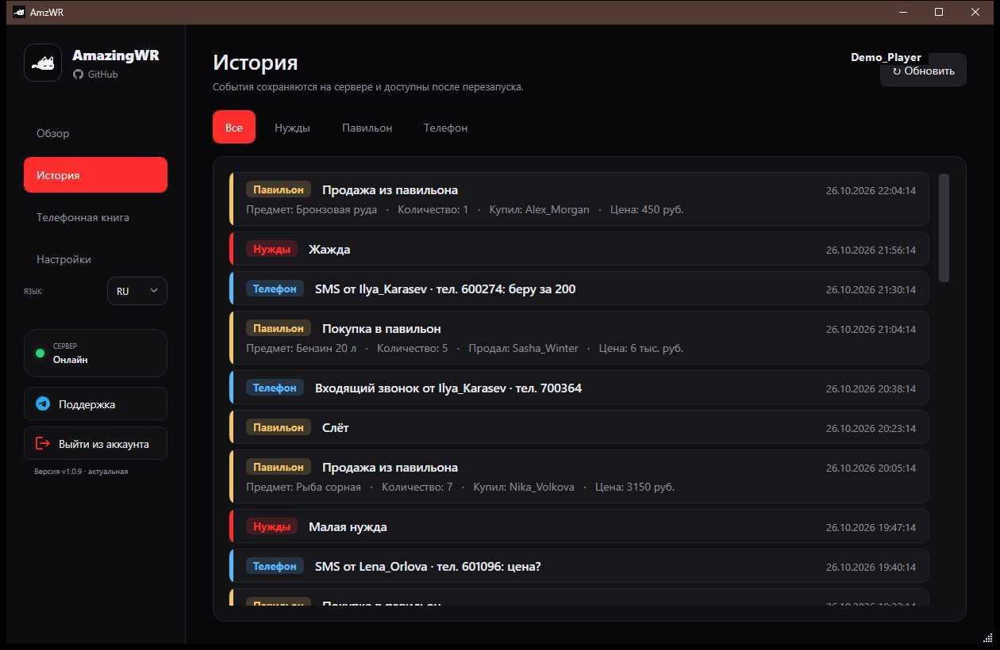
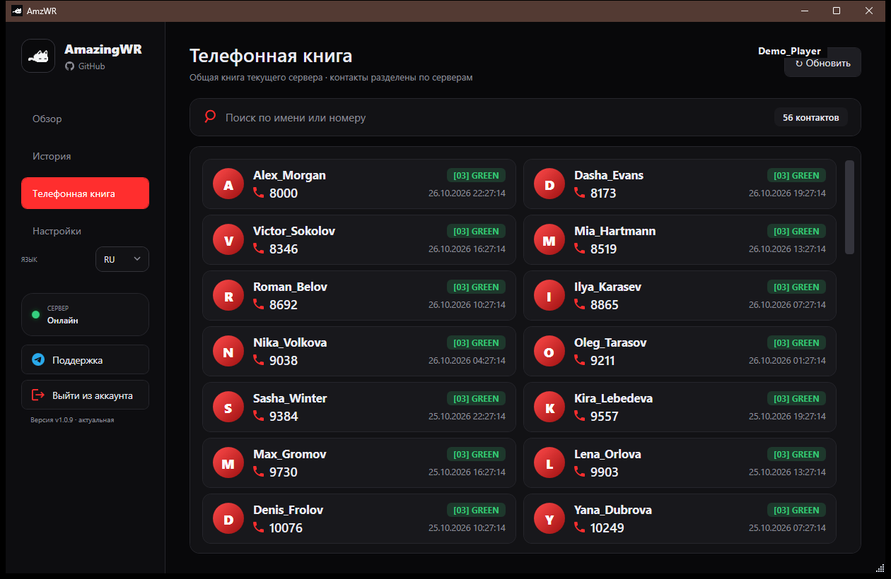
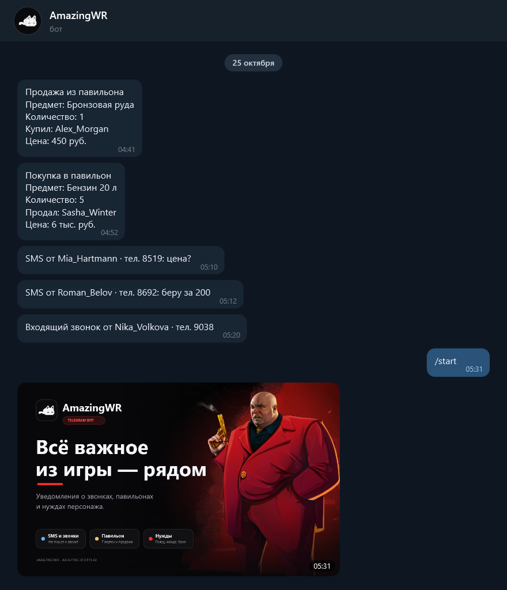

<p align="center">
  
</p>

<div align="center">

# AmazingWR

### Тихий помощник для Amazing RP: сделки, звонки и нужды персонажа — прямо в Telegram

Играйте спокойно: пока вы заняты, AmazingWR следит за чатом игры и сообщает о главном.

[⬇️ Скачать](https://github.com/DIRECT17/AmazingWR/releases/latest) &nbsp;·&nbsp; [🤖 Бот в Telegram](https://t.me/AmazingWR_bot) &nbsp;·&nbsp; [💬 Поддержка](https://t.me/AmzWR_support)

</div>

---

## 👋 Что это такое

AmazingWR — небольшая программа для Windows. Она читает файл `chatlog.txt`, который игра и так ведёт сама, замечает в нём важные события и показывает их в приложении и в вашем Telegram. В игру программа **не вмешивается** и её файлы не меняет.

Особенно удобна тем, кто торгует через павильон: не нужно сидеть в игре, чтобы не пропустить покупателя.

## ✨ Что вы получаете

- 🛒 **Сделки в павильоне.** Сообщения о покупке и продаже: предмет, количество, цена и имя игрока.
- 📊 **Статистика торговли.** На главном экране суммы продаж и закупок за сегодня, неделю и месяц.
- 📱 **Телефон.** Входящие SMS и звонки с именем и номером.
- 📒 **Телефонная книга.** Номера из SMS и объявлений собираются сами; книга отдельная для каждого сервера, поиск по имени и номеру.
- 🍞 **Нужды персонажа.** Напоминания о голоде, жажде, бане и малой нужде.
- ⏰ **Слёт павильона.** Напоминание в нужное вам время.
- 🕘 **История.** Все события сохраняются и остаются после перезапуска.
- 🔄 **Обновление в один клик.** Новая версия скачивается и ставится прямо из программы.

## 🖼️ Как это выглядит

<table>
  <tr>
    <th align="center">Главный экран</th>
    <th align="center">История уведомлений</th>
  </tr>
  <tr>
    <td></td>
    <td></td>
  </tr>
  <tr>
    <th align="center" colspan="2">Телефонная книга</th>
  </tr>
  <tr>
    <td colspan="2"></td>
  </tr>
</table>

### 💬 И то же самое в Telegram

Бот присылает короткие сообщения, поэтому о сделке можно узнать с телефона.

<p align="center"></p>

> Все изображения здесь сделаны на вымышленных данных.

## 🚀 Быстрый старт

Это займёт пару минут.

1. **Скачайте** `AmazingWR.exe` на [странице релиза](https://github.com/DIRECT17/AmazingWR/releases/latest) и запустите.
2. **Откройте бота** [@AmazingWR_bot](https://t.me/AmazingWR_bot) и нажмите «Запустить». Бот покажет ваш **Telegram ID** и даст пробный доступ.
3. **Придумайте пароль.** Нажмите в боте «🔑 Пароль для приложения» и отправьте пароль одним сообщением (от 6 до 64 символов). Бот сразу удалит это сообщение из чата.
4. **Войдите в программе** по Telegram ID и паролю. Галочки «Сохранить пароль» и «Входить автоматически» избавят от повторного ввода.
5. **Укажите `chatlog.txt`** игры в настройках и включите нужные уведомления на главном экране.

Готово — можно играть, остальное AmazingWR возьмёт на себя. 🎉

## ❓ Частые вопросы

<details>
<summary><b>Забыл пароль или хочу сменить</b></summary>

Откройте бота и снова нажмите «🔑 Пароль для приложения» (или отправьте `/password`). Старый пароль заменится новым, а открытая программа попросит войти заново.
</details>

<details>
<summary><b>Уведомления не приходят</b></summary>

Проверьте по порядку: на главном экране включён переключатель «Все функции»; в настройках указан правильный `chatlog.txt`; подписка активна; нужный тип уведомлений включён во вкладке «Уведомления». Если не помогло — напишите в [поддержку](https://t.me/AmzWR_support).
</details>

<details>
<summary><b>Можно ли войти с другого компьютера?</b></summary>

Один аккаунт привязывается к одному компьютеру. Если нужно перенести, напишите в [поддержку](https://t.me/AmzWR_support) — привязку сбросят.
</details>

<details>
<summary><b>Какие данные уходят на сервер?</b></summary>

Ваш Telegram ID, хеш пароля, игровой ник и сервер, версия Windows, внешний IP, события запуска, история уведомлений и номера из SMS и объявлений (они попадают в общую книгу вашего сервера игры). Пароль на сервере хранится только в виде хеша, а на вашем компьютере — в зашифрованном виде средствами Windows. Полный текст — в разделе «Условия использования» на экране входа.
</details>

<details>
<summary><b>Как обновиться?</b></summary>

Если вышла новая версия, в левом меню появится кнопка «Обновить». Нажмите её — программа сама скачает файл, проверит контрольную сумму и перезапустится.
</details>

## 🛠️ Для разработчиков

Клиент написан на .NET 10 (WPF) для Windows x64. Чтобы собрать его самостоятельно, установите [.NET 10 SDK](https://dotnet.microsoft.com/download/dotnet/10.0), откройте PowerShell в папке проекта и выполните:

```powershell
./scripts/build-app.ps1
```

Готовый файл появится в папке `dist/`. Скрипт сам перерисует значки и картинку для бота из исходников в `assets/`.

В репозитории только клиент; серверная часть и бот здесь не публикуются.

---

<sub>Названия и изображения Amazing RP принадлежат их правообладателям и используются в оформлении программы.</sub>
